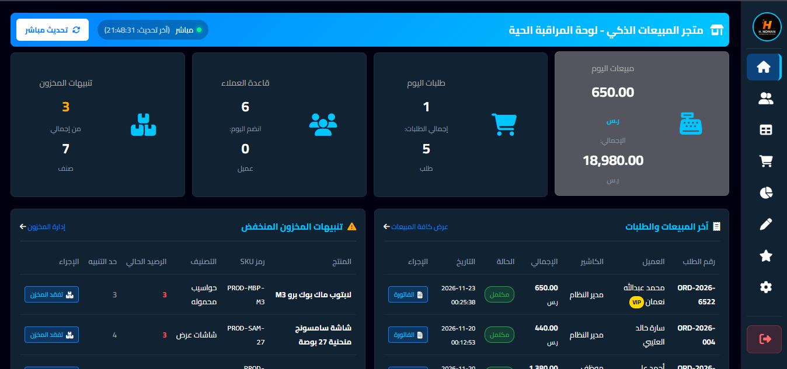
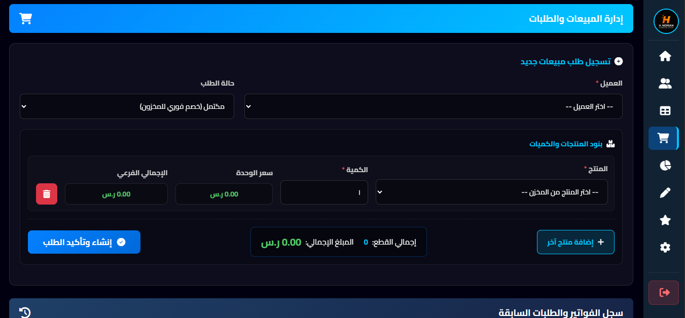
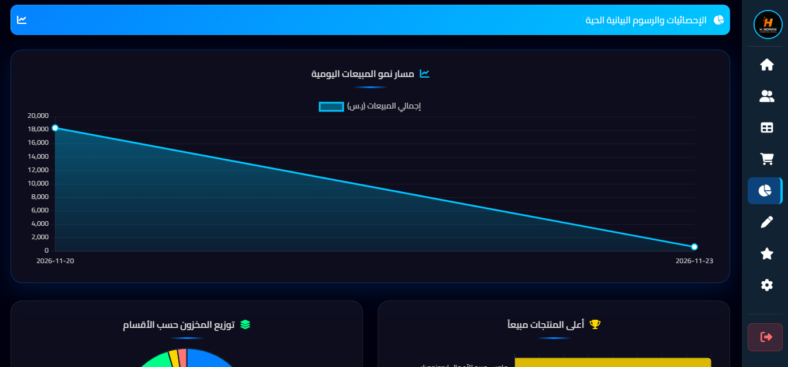
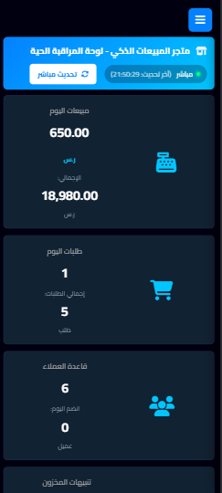

# لوحة متابعة المتجر والمبيعات عن بُعد (remote-store-dashboard-php)

نظام ويب متكامل لإدارة ومتابعة المبيعات، المخزون، والعملاء عن بُعد، مبني بلغة **PHP 8.2** وقاعدة بيانات **MySQL**، بواجهة مستخدم عربية كاملة (**RTL**) ذات تصميم عصري داكن (**Dark Navy & Glassmorphism**) متجاوب مع جميع الشاشات والأجهزة المحمولة، ويعمل بدون اتصال بالإنترنت بنسبة **100% Offline**.

---

## 📌 نظرة عامة وحالة الاستخدام الواقعية (Real-World Use Case)

صُمم النظام لتلبية احتياجات المتاجر ومنافذ البيع بالتجزئة من خلال توزيع واضح للمهام والصلاحيات:
1. **موظف المبيعات / الكاشير (Staff):**
   - تسجيل فواتير وطلبات البيع اليومية متعددة المنتجات مع احتساب فوري للمجاميع.
   - طباعة فواتير مبيعات عربية رسمية منسقة بضغطة زر واحدة.
   - إضافة وتعديل بيانات العملاء والمنتجات المتاحة في المخزن.
2. **مالك المتجر / المدير العام (Store Owner / Admin):**
   - متابعة مؤشرات الأداء الحيوية لحظياً عن بُعد من الهاتف أو الحاسوب عبر زر التحديث المباشر (**Live Refresh**).
   - رصد الإيرادات، إجمالي المبيعات، ومعدلات الأرباح الصافية.
   - تنبيهات فورية للمنتجات التي وصلت للحد الأدنى من المخزون لمنع نفاد البضائع.
   - تحليلات ورسوم بيانية أسبوعية وشهرية دقيقة لكفاءة المبيعات وتفاعل العملاء.
   - إدارة صلاحيات المستخدمين والتحكم الكامل في إعدادات وهوية المتجر.

---

## ✨ المميزات الرئيسية للنظام (Key Features)

- **لوحة متابعة تفاعلية (Live Monitoring Dashboard):** مؤشرات حية للأرباح، المبيعات اليومية، والمنتجات الحرجة مع مؤشر زمني لحظي لآخر تحديث وزر تحديث فوري بدون إعادة تحميل الصفحة بالكامل.
- **إدارة الطلبات والمبيعات والفواتير (Orders & Arabic Invoices):**
  - إنشاء طلبات متعددة المنتجات مع فحص آلي لتوفر المخزون.
  - معاملات قاعدة بيانات ذرية (**Atomic PDO Transactions**) تضمن خصم الكميات من المخزن تلقائياً، وإعادة ترجيعها فوراً عند إلغاء أي طلب.
  - فواتير مبيعات عربية رسمية قابلة للطباعة تتضمن شعار المتجر، بيانات العميل، والتفاصيل المالية.
- **نظام صلاحيات متعدد الأدوار (Role-Based Access Control - RBAC):** فصل محكم بين صلاحيات المدير (**Admin**) وموظفي المبيعات (**Staff**).
- **رسوم بيانية وتحليلات متقدمة (Offline Visual Charts):** مخططات بيانية تفاعلية باستخدام مكتبة **Chart.js** المحلية لرصد نمو المبيعات وتوزيع المنتجات الأكثر طلباً.
- **بحث وتصفية وترقيم من جهة الخادم (Server-Side Search, Filter & Pagination):** بحث فوري بالاسم، الهاتف، أو رقم الطلب مع فلترة دقيقة وتصفح سلس وسريع للبيانات الضخمة.
- **نظام تنبيهات ونوافذ تأكيد عصرية (Modern Toast Notifications & Confirm Modals):** استبدال كامل للتنبيهات التقليدية بنوافذ تأكيد زجاجية وتنبيهات عائمة تدعم تجربة المستخدم المتطورة.
- **تصميم متجاوب بالكامل للأجهزة المحمولة (Full RTL Mobile Responsive Design):**
  - قائمة درج جانبي منزلقة في الشاشات الصغيرة (**Drawer Sidebar**).
  - جداول بيانات متجاوبة بتمرير أفقي ناعم للأجهزة اللمسية.
  - نماذج إدخال مبنية بنظام **CSS Grid (1fr)** لضمان عدم انكسار الحقول في مختلف مقاسات الهواتف.
- **عمل كامل ومستقل دون إنترنت (100% Offline Ready):** تضمين محلي لكافة الخطوط (Cairo Font)، الأيقونات (Font Awesome)، والمكتبات البرمجية دون الاعتماد على أي خوادم خارجية CDN.

---

## 🛡️ معايير الأمان والبنية البرمجية (Security & Architecture)

- **الاستعلامات المهيأة (PDO Prepared Statements):** حماية مطلقة وشاملة ضد هجمات حقن قواعد البيانات (**SQL Injection**).
- **تشفير كلمات المرور (Password Hashing):** استخدام أحدث خوارزميات التشفير عبر دوال `password_hash()` و `password_verify()`.
- **حماية التزوير عبر المواقع (CSRF Protection):** توكن أمان فريد مشفر لكل جلسة ونموذج مدخلات، يتم التحقق منه قبل تنفيذ أي إجراء.
- **الحماية ضد هجمات XSS:** تعقيم وتطهير كافة البيانات المخرجة عبر دالة `e()` باستخدام `htmlspecialchars(..., ENT_QUOTES, 'UTF-8')`.
- **إدارة المتغيرات الحساسة (.env Configuration):** فصل بيانات الاتصال بقاعدة البيانات في ملف `.env` محمي ومستثنى من التتبع في Git.

### المخطط العلائقي لقاعدة البيانات (Relational Schema):
يتكون النظام من 7 جداول مترابطة بصلابة:
1. `users`: المستخدمين وأدوارهم (`admin`, `staff`).
2. `clients`: سجل العملاء وحالة التميز (VIP).
3. `products`: المنتجات، الأقسام، الأسعار، والمخزون وحدود التنبيه.
4. `orders`: الطلبات، أرقام الفواتير، والمبالغ الإجمالية والحالة.
5. `order_items`: تفاصيل البنود والكميات والأسعار لكل طلب.
6. `posts`: المنشورات والإعلانات الداخلية للمتجر.
7. `settings`: إعدادات المتجر العامة، العملة، وهوية النظام.

---

## 📸 لقطات من النظام (Screenshots)

| لوحة التحكم والمراقبة عن بُعد | إدارة المبيعات والفاتورة المطبوعة |
| :---: | :---: |
|  |  |
| *متابعة الإحصائيات والمخزون الحرج لحظياً* | *طباعة الفاتورة العربية وإدارة حالة الطلبات* |

| التحليلات والرسوم البيانية | التجاوب التام مع شاشات الهواتف |
| :---: | :---: |
|  |  |
| *مخططات تفاعلية أسبوعية وشهرية للمبيعات* | *قائمة منزلقة ونماذج مخصصة للهواتف الذكية* |

---

## 💻 التقنيات المستخدمة (Tech Stack)

- **Backend:** PHP 8.2 (Pure Native, Modular Architecture, PDO)
- **Database:** MySQL 8.x / MariaDB
- **Frontend:** Semantic HTML5, CSS3 (Modern Glassmorphism & CSS Grid), Pure JavaScript & jQuery 3.7.1
- **Icons & Typography:** Font Awesome 6.x (Local), Cairo Google Font (Local WOFF2)
- **Data Visualization:** Chart.js (Local)

---

## 📂 هيكل المشروع (Project Directory Structure)

```text
remote-store-dashboard-php/
├── api/                     # مسارات واجهات البيانات البرمجية اللحظية (AJAX Endpoints)
│   └── dashboard_stats.php
├── assets/                  # الأصول المنظمة والصور
│   └── images/              # شعار المتجر والصور الرمزية
│       ├── store-logo.png
│       └── avatar.png
├── charts/                  # وحدة التحليلات والرسوم البيانية
├── clients/                 # وحدة إدارة العملاء وتصنيفات VIP
├── config/                  # تكوينات النظام والاتصال بقاعدة البيانات PDO
│   └── database.php
├── Css/                     # ملفات التنسيق الموحدة والمتجاوبة
│   ├── login.css            # تنسيق صفحة الدخول الزجاجية
│   ├── responsive.css       # قواعد التجاوب لكافة الشاشات
│   ├── sidebar.css          # تنسيق القائمة الجانبية الموحدة
│   └── ui.css               # مكونات Toast ونوافذ التأكيد
├── database/                # ملفات المخطط الأولي SQL
├── docs/                    # التوثيق ولقطات الشاشة
│   └── screenshots/
├── fontawesome/             # حزمة أيقونات Font Awesome المحلية الكاملة
├── fonts/                   # خط Cairo المحلي بجميع الأوزان
├── includes/                # المكونات المشتركة ودوال الأمان والصلاحيات
│   ├── auth.php             # دوال الجلسات والمصادقة والأدوار
│   ├── security.php         # دوال CSRF و XSS والتطهير
│   └── sidebar.php          # القائمة الجانبية الموحدة لجميع الصفحات
├── js/                      # سكريبتات الواجهة والتنبيهات وإدارة النماذج
│   ├── login.js
│   └── ui.js
├── orders/                  # وحدة إدارة المبيعات والفواتير والطباعة
│   ├── invoice.php          # صفحة الفاتورة العربية المطبوعة
│   └── orders.php
├── posts/                   # إدارة المنشورات والإعلانات الداخلية
├── Products/                # وحدة المنتجات وتنبيهات المخزون
├── settings/                # وحدة إعدادات وهوية المتجر
├── tests/                   # سكريبتات الفحص والتحقق الآلي الشامل
├── .env.example             # نموذج متغيرات البيئة
├── .gitignore               # استثناء الملفات الحساسة والمؤقتة
├── index.php                # لوحة التحكم والمتابعة الرئيسية
├── Login.php                # صفحة تسجيل الدخول العصرية
├── login_process.php        # معالجة تسجيل الدخول الآمنة
├── logout.php               # تسجيل الخروج الآمن وإنهاء الجلسة
├── README.md                # وثيقة المشروع الشاملة
└── setup_db.php             # مثبت قاعدة البيانات والمستخدمين الافتراضيين
```

---

## 🚀 طريقة التثبيت والتشغيل المحلي (Quick Setup Guide)

### المتطلبات الأساسية:
- بيئة خادم محلي مثل **XAMPP** أو **WampServer** أو **Laragon** مع دعم **PHP 8.1+** أو **PHP 8.2**.
- تفعيل ملحقات `pdo_mysql` و `mbstring` في ملف `php.ini`.

### خطوات التثبيت:
1. **استنساخ المستودع:**
   ```bash
   git clone https://github.com/hishamanoman-oss/remote-store-dashboard-php.git
   cd remote-store-dashboard-php
   ```

2. **إعداد ملف متغيرات البيئة:**
   انسخ ملف `.env.example` إلى `.env`:
   ```bash
   cp .env.example .env
   ```
   *تأكد من مطابقة بيانات الاتصال بـ MySQL (اسم المستخدم وكلمة المرور) في ملف `.env`.*

3. **تثبيت وبناء قاعدة البيانات والمستخدمين تلقائياً:**
   افتح المتصفح أو موجه الأوامر وشغّل سكريبت الإعداد:
   ```bash
   php setup_db.php
   ```
   *يقوم هذا السكريبت بإنشاء قاعدة البيانات `myproject_db`، الجداول السبعة، وإدخال بيانات متجر واقعية ومستخدمين تجريبيين مشفرين بالكامل.*

4. **تشغيل النظام:**
   افتح المتصفح وانتقل إلى:
   ```text
   http://localhost/remote-store-dashboard-php/Login.php
   ```

---

## 🔑 بيانات الدخول التجريبية (Demo Credentials)

| الدور (Role) | البريد الإلكتروني (Email) | كلمة المرور (Password) | الصلاحيات المتاحة |
| :--- | :--- | :--- | :--- |
| **المدير العام (Admin)** | `admin@store.com` | `Admin@123` | كامل الصلاحيات: لوحة المراقبة، المبيعات، الفواتير، المنتجات، العملاء، التقارير، والإعدادات. |
| **موظف المبيعات (Staff)** | `staff@store.com` | `Staff@123` | تسجيل الطلبات والمبيعات، طباعة الفواتير، إضافة العملاء والمنتجات، وعرض المنشورات. |

---

## 👨‍💻 المطور (Author)

- **الاسم:** هشام نعمان (Hisham Noman)
- **حساب GitHub:** [@hishamanoman-oss](https://github.com/hishamanoman-oss)
