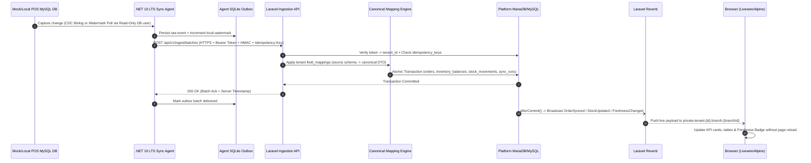
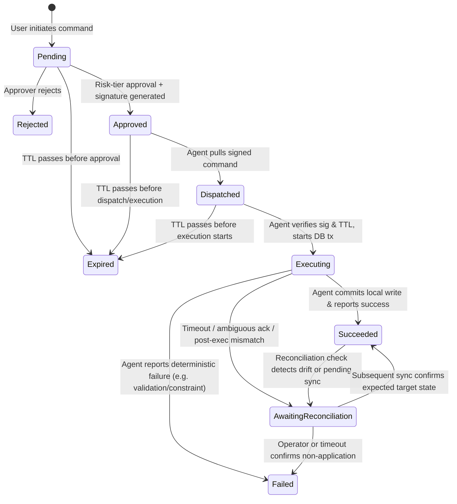

# Data Flow, Integration & Command Center Architecture

**Document Status:** Phase 01 Architectural Blueprint (Approved Baseline)  

---

## 1. Real-Time vs. Eventually Consistent Boundaries

To maintain architectural honesty, the platform draws a hard boundary between **eventually consistent edge synchronization** and **real-time platform UI updates**:

| Stage | Consistency Model | Mechanism & Latency Expectations |
| :--- | :--- | :--- |
| **1. Local POS Commit -> Agent Capture** | **Eventually Consistent** | CDC/Binary Log (sub-second to ~2s) or Incremental Polling (configurable 5s–60s). If offline, buffered in Agent SQLite outbox indefinitely until reconnect. |
| **2. Agent -> Laravel Ingestion API** | **Eventually Consistent** | Outbound HTTPS batched upload with exponential backoff and `idempotency_keys`. |
| **3. Laravel DB Commit -> Browser UI** | **Real-Time** | Immediately after `DB::commit()`, `ShouldBroadcastAfterCommit` pushes updates via **Laravel Reverb** (<500ms locally) to active Livewire/Alpine subscribers. |

---

## 2. End-to-End Read/Sync Data Flow



---

## 3. Connector Capability Contract & Freshness State Machine

### 3.1 Connector Capability Contract
Every connector implementation declares a structured capability contract stored/validated in `Integration`:

```json
{
  "connector_type": "mysql_local_agent",
  "display_name": "Local MySQL / MariaDB via .NET Sync Agent",
  "requires_local_agent": true,
  "capture_strategies": ["cdc_binlog", "incremental_polling"],
  "default_capture_strategy": "incremental_polling",
  "supports_webhooks": false,
  "supports_write_commands": true,
  "supported_command_types": [
    "SYNC_NOW",
    "UPDATE_PRODUCT_PRICE",
    "ADJUST_STOCK",
    "SET_REORDER_THRESHOLD",
    "UPDATE_ORDER_STATUS"
  ],
  "max_batch_size": 500,
  "heartbeat_interval_seconds": 30
}
```

### 3.2 Honest Data Freshness State Machine
Each `data_source` computes and exposes its honest freshness state:

| State | Entry Condition | UI Semantics |
| :--- | :--- | :--- |
| **`Live`** | Last heartbeat <= `2x heartbeat_interval` AND last successful sync lag <= `freshness_sla_seconds` AND zero fatal errors | Green indicator + exact `last_synced_at` relative timestamp |
| **`Syncing`** | Active ingestion batch or catch-up backfill currently executing | Blue animated indicator + progress count |
| **`Delayed`** | Heartbeat alive, but sync lag > `freshness_sla_seconds` (e.g., backlog catch-up or high POS load) | Amber indicator + exact lag duration (e.g., `Delayed by 4m`) |
| **`Disconnected`** | No heartbeat received for > `3x heartbeat_interval` | Gray/Red offline indicator + `Last seen at ...` |
| **`Error`** | Consecutive ingestion validation, auth, or local DB read errors >= threshold | Red alert indicator + sanitized diagnostic code |

---

## 4. Canonical Data Normalization & `field_mappings` Strategy

The platform never hardcodes third-party POS table or column names in its business modules. Instead, `field_mappings` defines declarative per-source mappings.

**Example: Phase 02 Mock Local POS MySQL DB -> Canonical Platform Schema**

| Mock POS Source (`table.column`) | Transform / Rule | Canonical Target (`table.column`) |
| :--- | :--- | :--- |
| `pos_tx_hdr.hdr_id` | `to_string` | `orders.external_id` |
| `pos_tx_hdr.doc_no` | `trim` | `orders.order_number` |
| `pos_tx_hdr.store_code` | `lookup(branches.external_code)` | `orders.branch_id` |
| `pos_tx_hdr.gross_val` | `decimal(14,2)` | `orders.gross_amount` |
| `pos_tx_hdr.disc_val` | `decimal(14,2)` | `orders.discount_amount` |
| `pos_tx_hdr.tax_val` | `decimal(14,2)` | `orders.tax_amount` |
| `pos_tx_hdr.paid_val` | `decimal(14,2)` | `orders.paid_amount` |
| `item_master.sku_code` | `upper_trim` | `product_variants.sku` |
| `item_master.unit_cost_amt` | `nullable_decimal(14,4)` | `product_variants.cost_price` |
| `wh_stock_bal.qty_phys` | `decimal(18,4)` | `inventory_balances.on_hand` |
| `wh_stock_bal.qty_hold` | `decimal(18,4)` | `inventory_balances.reserved` |

- `available` is **always computed canonically** (`on_hand - reserved`) and cross-checked against source values if provided.
- Unmapped or invalid rows are quarantined into `sync_runs.error_summary` / dead-letter payloads without poisoning valid rows in the same batch (unless transactional atomicity of a single order header+lines fails, in which case that entire order unit is rejected together).

---

## 5. .NET 10 LTS Local Sync Agent Security Model

1. **Zero Inbound Ports:** The agent acts purely as an HTTPS client initiating outbound TLS 1.2/1.3 connections to the platform. No firewall port forwarding or public IP is required on the customer premise.
2. **Credential Isolation (Read-Only vs. Write):**
   - **Sync Credential (`rbd_sync_ro`):** Granted `SELECT` only on mapped source tables (plus `REPLICATION SLAVE / CLIENT` if CDC Binlog mode is enabled).
   - **Command Write Credential (`rbd_cmd_rw`):** Optional, disabled by default. Stored separately and granted `EXECUTE` / narrowly scoped `UPDATE`/`INSERT` only on specific allowlisted tables/procedures.
3. **At-Rest Protection:** All DB connection strings, agent API bearer tokens, and command verification public keys are encrypted locally using **Windows DPAPI** (`ProtectedData.Protect` scoped to `LocalMachine`/service account).
4. **Local SQLite Resilience Store:** Stores pending outbound batches, last committed CDC binlog file/position or watermark timestamps, and locally recorded command execution receipts to guarantee at-least-once delivery paired with server-side `idempotency_keys`.
5. **Payload Integrity:** Every HTTP batch includes `X-Agent-Id`, `X-Idempotency-Key`, `X-Timestamp`, and `X-Signature` (HMAC-SHA256) to prevent replay and payload tampering.

---

## 6. Remote Command Center Architecture (Controlled Write Operations)

### 6.1 Hard Security Invariants
- **Zero Arbitrary SQL:** Neither the API, database, nor `.NET 10 LTS` agent ever sends, accepts, or executes raw SQL strings. Every command uses a strongly typed `command_type` + JSON schema validated payload executed by a compiled, parameterized C# command handler.
- **Separate Approval & Execution:** Initiating a command never executes it directly unless low-risk auto-approval policy explicitly permits it.

### 6.2 Command Outbox Lifecycle State Machine



### 6.3 Required States & Semantics
1. `Pending` — Created in `remote_commands` outbox; awaiting risk-tier approval.
2. `Approved` — Approved by authorized role; server computes cryptographic signature (`Ed25519` or `HMAC-SHA256` over `command_id + tenant_id + data_source_id + command_type + canonical_payload + expires_at + idempotency_key`).
3. `Dispatched` — Delivered to the authenticated `.NET 10 LTS` agent over outbound HTTPS command polling.
4. `Executing` — Agent verified signature, `expires_at > utc_now`, and `idempotency_key` (not previously run in SQLite), and began local parameterized DB transaction using write credentials.
5. `Succeeded` — Source DB transaction committed and verified (either immediately or after reconciliation confirmation).
6. `Failed` — Deterministic refusal or rollback (e.g., SKU missing, insufficient stock for negative adjustment, signature mismatch).
7. `Expired` — `expires_at` elapsed prior to execution; permanently non-executable.
8. `Rejected` — Explicitly declined during approval review with mandatory reason.
9. `Awaiting Reconciliation` — Ambiguous outcome (e.g., network drop after execution start, or agent reported success while subsequent sync snapshot does not yet reflect the expected target state). Requires automated sync verification or manual operator resolution.

### 6.4 Risk Tiers & Governance

| Risk Tier | Example Commands | Approval Requirement | TTL Window |
| :--- | :--- | :--- | :--- |
| **Low** | `SYNC_NOW`, minor `SET_REORDER_THRESHOLD` | Auto-approved or single Branch/Inventory Manager | 15 minutes |
| **Medium** | `UPDATE_PRODUCT_PRICE` (<= 15% delta), bounded `ADJUST_STOCK` | General Manager or Tenant Owner (four-eyes enforced if configured) | 30 minutes |
| **High** | `UPDATE_PRODUCT_PRICE` (> 15% delta), large `ADJUST_STOCK`, `UPDATE_ORDER_STATUS` | Tenant Owner + step-up password/2FA confirmation | 15 minutes |
