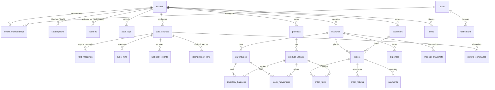

# Canonical ERD & Data Ownership Matrix

**Document Status:** Phase 01 Architectural Blueprint (Approved Baseline)  
**Target RDBMS:** MariaDB 11.4 LTS / MySQL 8.4 LTS (`utf8mb4_unicode_ci`, strict SQL mode)  

---

## 1. Schema Integrity Rules (Mandatory)

1. **Many-to-Many Tenancy (`tenant_memberships`):** There is **NO** direct `tenants.user_id` foreign key. Users connect to tenants exclusively through `tenant_memberships`, allowing multi-tenant SaaS memberships and keeping Platform Super Admins cleanly separated.
2. **Explicit Sync & Mapping Tables:** `field_mappings`, `webhook_events`, and `idempotency_keys` are first-class canonical tables.
3. **Exact Arithmetic:** All monetary columns use `DECIMAL(14,2)` (or `DECIMAL(14,4)` for unit costs); all inventory quantities use `DECIMAL(18,4)`. `FLOAT` / `DOUBLE` are strictly forbidden.
4. **Tenant Scoping:** Every business, integration, inventory, financial, and command table carries `tenant_id BIGINT UNSIGNED NOT NULL` with composite indexing.

---

## 2. Canonical Entity-Relationship Diagram (ERD)

---

## 3. Core Table Specifications

### 3.1 Tenancy, Identity & Licensing
| Table | Key Columns | Constraints & Notes |
| :--- | :--- | :--- |
| `tenants` | `id`, `uuid`, `name`, `slug`, `deployment_mode` (`saas`/`self_hosted`), `status`, `default_currency`, `default_locale`, `timezone` | Root tenant record; zero direct FK to `users` |
| `users` | `id`, `name`, `email`, `password`, `is_platform_admin`, `two_factor_secret`, `locale`, `theme_preference`, `is_active` | Global identity; `is_platform_admin` strictly separated from tenant roles |
| `tenant_memberships` | `id`, `tenant_id`, `user_id`, `role` (`owner`, `general_manager`, `branch_manager`, `accountant`, `inventory_manager`, `observer`), `branch_scope` (JSON), `warehouse_scope` (JSON), `status`, `invited_by` | `UNIQUE (tenant_id, user_id)` — enforces many-to-many |
| `subscriptions` | `id`, `tenant_id`, `plan_code`, `status`, `seat_limit`, `branch_limit`, `source_limit`, `current_period_end` | Active in SaaS mode |
| `licenses` | `id`, `tenant_id`, `license_key_id`, `payload_json`, `signature`, `issued_at`, `expires_at`, `status` | Active in Self-Hosted mode |
| `audit_logs` | `id`, `tenant_id` (nullable for platform actions), `actor_user_id`, `actor_role`, `event_type`, `auditable_type`, `auditable_id`, `old_values`, `new_values`, `ip_address`, `created_at` | Append-only audit trail |

### 3.2 Integration, Mapping & Idempotency
| Table | Key Columns | Constraints & Notes |
| :--- | :--- | :--- |
| `data_sources` | `id`, `tenant_id`, `branch_id` (nullable), `name`, `connector_type`, `capture_strategy` (`webhook`, `cdc_binlog`, `incremental_polling`), `freshness_status` (`live`, `delayed`, `syncing`, `disconnected`, `error`), `last_heartbeat_at`, `last_synced_at`, `write_enabled`, `agent_token_hash`, `command_public_key` | Represents each connected POS/accounting endpoint |
| `field_mappings` | `id`, `tenant_id`, `data_source_id`, `source_entity`, `source_field`, `canonical_entity`, `canonical_field`, `transform_rule` (JSON), `default_value`, `is_required`, `is_active` | Declarative schema mapping (e.g., `pos_tx_hdr.hdr_total` -> `orders.gross_amount`) |
| `sync_runs` | `id`, `tenant_id`, `data_source_id`, `run_uuid`, `capture_strategy`, `status`, `watermark_from`, `watermark_to`, `records_received`, `records_applied`, `records_failed`, `error_summary`, `started_at`, `finished_at` | Tracks ingestion batches & latency |
| `webhook_events` | `id`, `tenant_id`, `data_source_id`, `external_event_id`, `event_type`, `signature_valid`, `payload_json`, `processing_status` (`pending`, `processed`, `failed`, `dead_letter`), `attempts`, `error_message`, `received_at`, `processed_at` | Raw staging & replayability for webhook/push connectors |
| `idempotency_keys` | `id`, `tenant_id`, `data_source_id`, `scope` (`ingest_batch`, `webhook`, `remote_command`), `idempotency_key`, `request_hash`, `response_status`, `response_body`, `expires_at`, `created_at` | `UNIQUE (tenant_id, scope, idempotency_key)` — guarantees zero duplicate writes |

### 3.3 Branches, Warehouses & Inventory Ledger
| Table | Key Columns | Constraints & Notes |
| :--- | :--- | :--- |
| `branches` | `id`, `tenant_id`, `external_code`, `name`, `timezone`, `currency`, `is_active` | `UNIQUE (tenant_id, external_code)` |
| `warehouses` | `id`, `tenant_id`, `branch_id` (nullable if central), `external_code`, `name`, `is_active` | Supports 1:N branch-to-warehouse or shared central warehouse |
| `products` | `id`, `tenant_id`, `external_id`, `name`, `category`, `unit_of_measure`, `track_inventory`, `is_active` | Canonical product master |
| `product_variants` | `id`, `tenant_id`, `product_id`, `external_id`, `sku`, `barcode`, `selling_price` (`DECIMAL(14,2)`), `cost_price` (`DECIMAL(14,4)` nullable), `reorder_threshold` (`DECIMAL(18,4)`) | `cost_price IS NULL` triggers COGS completeness warning |
| `inventory_balances` | `id`, `tenant_id`, `warehouse_id`, `product_variant_id`, `on_hand` (`DECIMAL(18,4)`), `reserved` (`DECIMAL(18,4)`), `available` (`DECIMAL(18,4)`), `last_movement_id`, `updated_at` | `UNIQUE (tenant_id, warehouse_id, product_variant_id)`; invariant `available = on_hand - reserved` |
| `stock_movements` | `id`, `tenant_id`, `warehouse_id`, `product_variant_id`, `movement_type`, `quantity_delta` (`DECIMAL(18,4)`), `balance_on_hand_after` (`DECIMAL(18,4)`), `balance_reserved_after` (`DECIMAL(18,4)`), `reference_type`, `reference_id`, `external_movement_id`, `occurred_at`, `created_at` | **Immutable append-only ledger** (`UPDATE`/`DELETE` prohibited at app & policy level) |

### 3.4 Sales, Customers & Financial Snapshots
| Table | Key Columns | Constraints & Notes |
| :--- | :--- | :--- |
| `customers` | `id`, `tenant_id`, `external_id`, `primary_branch_id`, `name`, `phone`, `email`, `is_vip`, `vip_tier`, `credit_limit` (`DECIMAL(14,2)`), `outstanding_balance` (`DECIMAL(14,2)`) | Deduplicated per `(tenant_id, external_id)` |
| `orders` | `id`, `tenant_id`, `branch_id`, `customer_id`, `data_source_id`, `external_id`, `order_number`, `status`, `payment_status`, `gross_amount` (`DECIMAL(14,2)`), `discount_amount` (`DECIMAL(14,2)`), `refund_amount` (`DECIMAL(14,2)`), `net_amount` (`DECIMAL(14,2)`), `tax_amount` (`DECIMAL(14,2)`), `paid_amount` (`DECIMAL(14,2)`), `outstanding_amount` (`DECIMAL(14,2)`), `cogs_amount` (`DECIMAL(14,4)` nullable), `cogs_complete` (bool), `ordered_at` | Strictly separates all financial components |
| `order_items` | `id`, `tenant_id`, `order_id`, `product_variant_id`, `warehouse_id`, `quantity` (`DECIMAL(18,4)`), `unit_price` (`DECIMAL(14,2)`), `discount_amount` (`DECIMAL(14,2)`), `tax_amount` (`DECIMAL(14,2)`), `line_net_amount` (`DECIMAL(14,2)`), `unit_cost` (`DECIMAL(14,4)` nullable) | Stores point-in-time cost snapshot |
| `order_returns` | `id`, `tenant_id`, `order_id`, `branch_id`, `external_id`, `refund_amount` (`DECIMAL(14,2)`), `tax_refund_amount` (`DECIMAL(14,2)`), `reason`, `returned_at` | Drives explicit `refund_amount` without erasing `gross_amount` |
| `payments` | `id`, `tenant_id`, `order_id`, `external_id`, `method`, `amount` (`DECIMAL(14,2)`), `paid_at` | Tracks `paid_amount` and `outstanding_amount` |
| `expenses` | `id`, `tenant_id`, `branch_id`, `category`, `amount` (`DECIMAL(14,2)`), `incurred_on`, `source` (`synced`/`manual`) | Required for complete Net Profit computation |
| `financial_snapshots` | `id`, `tenant_id`, `branch_id` (nullable for tenant rollup), `period_type` (`daily`/`monthly`), `period_date`, `gross_sales`, `discounts`, `refunds`, `net_sales`, `tax_total`, `paid_total`, `outstanding_total`, `cogs_total` (nullable), `expenses_total` (nullable), `net_profit` (nullable), `profit_completeness_status` (`complete`, `partial_cogs`, `missing_expenses`, `incomplete`), `missing_inputs_flags` (JSON) | **`net_profit` MUST be `NULL` whenever `profit_completeness_status != 'complete'`** |

### 3.5 Remote Command Center & Alerts
| Table | Key Columns | Constraints & Notes |
| :--- | :--- | :--- |
| `remote_commands` | `id`, `tenant_id`, `data_source_id`, `branch_id`, `command_type`, `risk_tier` (`low`, `medium`, `high`), `payload_json`, `idempotency_key`, `status` (`pending`, `approved`, `dispatched`, `executing`, `succeeded`, `failed`, `expired`, `rejected`, `awaiting_reconciliation`), `requested_by`, `approved_by`, `signature`, `expires_at`, `dispatched_at`, `executed_at`, `reconciled_at`, `result_message`, `reconciliation_notes` | Command Outbox enforcing signed, expiring, reconciled remote writes |
| `alert_rules` / `alerts` / `notifications` / `announcements` | Standard tenant-scoped operational alerting, read receipts, and internal posts | Real-time delivery via Reverb |

---

## 4. Source of Truth & Data Ownership Matrix

| Domain Entity / Dataset | Primary Source of Truth | Sync / Control Direction | Conflict & Reconciliation Rule |
| :--- | :--- | :--- | :--- |
| **Tenants, Users, `tenant_memberships`, RBAC** | **Platform-Owned** | Platform internal | Authoritative in platform DB; never overwritten by POS sync |
| **Subscriptions & Signed Licenses** | **Platform-Owned** | Platform internal | Enforced strictly at platform control plane |
| **`data_sources` & `field_mappings`** | **Platform-Owned** | Platform -> Agent (config pull) | Configured in Integration Center UI |
| **POS Orders, Order Items, Returns, Payments** | **Source-Owned** (Local POS/Accounting) | Source -> Platform (Read Sync) | Platform stores canonical projection; corrections occur via POS sync or explicit `UPDATE_ORDER_STATUS` command |
| **Customers & Receivables** | **Source-Owned** (with Platform VIP tags optional) | Source -> Platform | Core balances originate from POS; platform-only VIP tags preserved on merge |
| **Physical Stock (`on_hand`, `reserved`) & Movements** | **Source-Owned** (or **Dual** when `ADJUST_STOCK` used) | Source -> Platform; Platform Command -> Source -> Reconciled | Source POS stock mutations flow inbound; remote `ADJUST_STOCK` commands write to source first, then reconcile on next sync |
| **Product Prices & Reorder Thresholds** | **Dual / Command-Reconciled** | Source -> Platform; Platform Command -> Source -> Reconciled | Platform never silently diverges from source; price edits go via `remote_commands` and reconcile |
| **`expenses` & `financial_snapshots`** | **Hybrid** (Synced + Platform-Owned Snapshot Engine) | Source/Manual -> Snapshot Engine | Platform owns aggregation and `profit_completeness_status` guardrail |
| **`remote_commands` & `audit_logs`** | **Platform-Owned** | Platform -> Agent (Command Outbox) | Immutable lifecycle owned by Platform Command Center |
