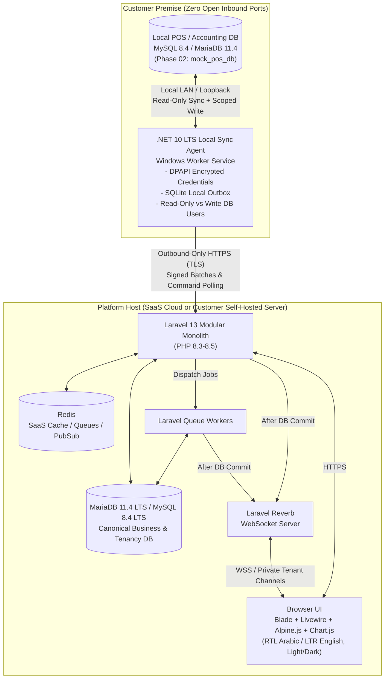

# System Architecture — Remote Business Platform

**Document Status:** Phase 01 Architectural Blueprint (Approved Baseline)  
**Architecture Style:** Laravel 13 Modular Monolith + Outbound-Only .NET 10 LTS Edge Sync Agent  

---

## 1. High-Level Topology

---

## 2. Laravel 13 Modular Monolith Boundaries

The application is organized into cohesive internal domain modules under `app/Modules/` with explicit service contracts and DTOs. Direct cross-module table joins or model mutations are prohibited except through documented read-model projections or module service interfaces.

| Module | Namespace | Owned Tables | Primary Responsibilities |
| :--- | :--- | :--- | :--- |
| **Platform** | `App\Modules\Platform` | `tenants`, `subscriptions`, `plans`, `licenses` | Deployment mode resolution (`saas`/`self_hosted`), plan quotas, signed license validation |
| **Identity** | `App\Modules\Identity` | `users`, `tenant_memberships`, `audit_logs`, `sessions` | Auth, 2FA, 7-role RBAC, branch/warehouse scoping, `TenantContext` binding, audit trail |
| **Integration** | `App\Modules\Integration` | `data_sources`, `field_mappings`, `sync_runs`, `webhook_events`, `idempotency_keys` | Connector capability registry, ingestion API, normalization pipeline, freshness state tracking |
| **CatalogInventory** | `App\Modules\CatalogInventory` | `branches`, `warehouses`, `products`, `product_variants`, `inventory_balances`, `stock_movements` | Multi-branch/warehouse catalog, `on_hand`/`reserved`/`available` invariants, immutable movement ledger |
| **SalesFinance** | `App\Modules\SalesFinance` | `customers`, `orders`, `order_items`, `order_returns`, `payments`, `expenses`, `financial_snapshots` | Exact `DECIMAL` sales/refunds/tax/AR calculations, COGS & Net Profit completeness guardrails |
| **CommandCenter** | `App\Modules\CommandCenter` | `remote_commands` | Command Outbox, risk-based approvals, cryptographic signing, TTL expiry, agent dispatch, reconciliation |
| **ReportingAlerts** | `App\Modules\ReportingAlerts` | `alert_rules`, `alerts`, `notifications`, `announcements` | Threshold alerts, notifications, announcements, CSV/XLSX/PDF exports |
| **Realtime** | `App\Modules\Realtime` | *(stateless broadcast contracts)* | Private channel authorization (`tenant.{id}`, `branch.{id}`) and `afterCommit` Reverb event dispatching |

### Module Communication Rules
1. **Sync Ingestion Pipeline:** `Integration` receives external payloads, normalizes them via `field_mappings`, and invokes `CatalogInventory` and `SalesFinance` application services inside an atomic database transaction.
2. **Post-Commit Real-Time Broadcasts:** Domain events dispatched during DB transactions MUST implement `ShouldBroadcastAfterCommit` (or be emitted inside `DB::afterCommit(...)`) so browser clients **never** query uncommitted or rolled-back state.
3. **Command Execution Loop:** `CommandCenter` validates intent & approvals, writes `remote_commands` outbox, and after agent execution notifies `Integration` reconciliation checks against incoming sync snapshots.

---

## 3. SaaS vs. Self-Hosted Deployment Profiles

A single codebase adapts to both deployment models via configuration (`APP_DEPLOYMENT_MODE=saas|self_hosted`) and strategy interfaces (`EntitlementServiceInterface`).

| Aspect | SaaS Profile (`saas`) | Self-Hosted Profile (`self_hosted`) |
| :--- | :--- | :--- |
| **Tenancy** | Multi-tenant shared DB; users linked via `tenant_memberships`; tenant switcher enabled | Single-tenant default (same `tenant_id` schema); optional multi-entity within license limits |
| **Super Admin Portal** | Enabled (`/admin`) for SaaS operators | Disabled or restricted to local instance administrator |
| **Commercial Gate** | `SubscriptionEntitlementService` (plans, Stripe/billing hooks, seat/branch quotas) | `LicenseEntitlementService` (offline Ed25519 signed `.lic` file verification) |
| **Cache & Queue** | **Redis** mandatory (cluster/sentinel capable) | **Database** queue + file/database cache default; **Redis** optional for high volume |
| **WebSockets (Reverb)** | Scaled with Redis Pub/Sub scaling driver | Single-node Reverb process |
| **Database Engine** | Managed MariaDB 11.4 LTS / MySQL 8.4 LTS | Customer-managed MariaDB 11.4 LTS / MySQL 8.4 LTS |

---

## 4. Defense-in-Depth Tenant Isolation Strategy

Relying solely on Eloquent Global Scopes is insufficient (raw queries, joins, queued jobs, caches, and WebSocket channels can bypass model scopes). The platform enforces **five concentric isolation layers**:

1. **Layer 1 — Authoritative Context Binding (`TenantContext`):**
   - For authenticated web/API users: `ResolveTenantContext` middleware resolves the active `tenant_id` from route/session and verifies an active row exists in `tenant_memberships` for `auth()->id()`. Client-supplied `X-Tenant-ID` headers are never trusted without membership verification.
   - For Local Sync Agents: `AuthenticateSyncAgent` middleware binds `TenantContext` cryptographically from the hashed agent token's `(tenant_id, data_source_id)` record. Payloads claiming a different `tenant_id` are immediately rejected (`403`).
2. **Layer 2 — Mandatory `tenant_id` & Scoped Models/Repositories:**
   - Every tenant-owned table includes `tenant_id` (`BIGINT UNSIGNED NOT NULL`, indexed as leading column in composite indexes `(tenant_id, ...)`).
   - Eloquent `BelongsToTenant` trait applies automatic global scope AND auto-fills `tenant_id` on creation, throwing a `MissingTenantContextException` if `TenantContext` is unset (fail-closed, never silent!).
   - Repository methods using `DB::table()` or raw SQL must accept a mandatory `TenantContext $ctx` parameter.
3. **Layer 3 — Branch & Warehouse Scope Enforcement:**
   - Policies read `TenantMembership->branch_scope` and `warehouse_scope` so a `Branch Manager` or `Inventory Manager` cannot access sibling branches within the same tenant.
4. **Layer 4 — Queues, Cache & Storage Partitioning:**
   - All tenant-scoped queued jobs implement `TenantAwareJob`, serializing `tenant_id` and re-binding `TenantContext` inside middleware before `handle()` executes, then clearing it in `finally`.
   - Cache keys are strictly prefixed: `tenant:{tenant_id}:{module}:{key}`.
   - Uploaded assets/exports are stored under `tenants/{tenant_id}/...` on private disks served only via authorized signed controllers.
5. **Layer 5 — Laravel Reverb Channel Authorization & CI Isolation Gate:**
   - Broadcast channels follow `private-tenant.{tenantId}.dashboard` and `private-tenant.{tenantId}.branch.{branchId}`. Channel callbacks verify both `tenant_memberships` and `branch_scope`.
   - Automated PHPUnit/Pest isolation tests run in CI attempting cross-tenant reads, writes, job runs, and broadcasts.

---

## 5. Legacy Preservation & Local No-XAMPP Runtime Policy

### Legacy Backup Isolation
- All existing procedural PHP files (`index.php`, `Login.php`, `orders/`, `Products/`, `clients/`, `charts/`, `includes/`, `config/`, `database/`, etc.) are preserved strictly as a **read-only reference backup**.
- The new Laravel 13 application will be hosted in its own clean directory boundary (defined in Phase 02, e.g., `platform/` and `agent/` or clean branch structure approved before scaffolding) so legacy PHP files remain 100% untouched.

### Local No-XAMPP Runtime & Live Browser Verification Workflow
Local development and automated verification **must NOT use XAMPP** (no Apache service or XAMPP control panel). Instead, standalone local processes run side-by-side:

| Service | Standalone Local Command | Purpose |
| :--- | :--- | :--- |
| **Web / App Server** | `php artisan serve --host=127.0.0.1 --port=8000` | Serves Laravel 13 HTTP routes & Ingestion API |
| **Database Server** | Standalone MySQL 8.4 LTS or MariaDB 11.4 LTS service (`127.0.0.1:3306`) | Hosts `rbd_platform` (canonical DB) and `mock_pos_db` (Phase 02 Mock POS DB) |
| **WebSockets** | `php artisan reverb:start --host=127.0.0.1 --port=8080` | Real-time post-commit UI pushes |
| **Queue Worker** | `php artisan queue:work --tries=3` | Async ingestion normalization, snapshots, alerts, reconciliation |
| **Frontend Assets** | `npm run dev` (Vite) | Compiles Tailwind/CSS tokens, Alpine.js, Chart.js offline bundles |
| **Sync Agent (Phase 05B+)** | `dotnet run` (`.NET 10 LTS` Worker Service) | Syncs `mock_pos_db` -> Laravel Ingestion API & executes signed commands |
| **E2E Verification** | `npx playwright test` + manual live browser | Tests real DB data, real WebSockets, RTL/LTR, Light/Dark, and mobile viewports |
