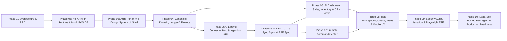

# Implementation Roadmap (11-Phase Plan)

**Document Status:** Phase 01 Architectural Blueprint (Approved Baseline)  
**Structure:** Phase 01 through Phase 10 (including Phase 05A & Phase 05B)  

---

## 1. Phase Dependency Overview

---

## 2. Detailed Phase Breakdown & Definition of Done

### Phase 01 — Product Architecture & Requirements *(Current Phase)*
- **Scope:** Complete architectural, product, schema, integration, role, and ADR documentation under `docs/product/` and `docs/architecture/`. Legacy PHP app untouched.
- **Dependencies:** None.
- **Definition of Done (Acceptance Gate):**
  - All 8 blueprint documents created and internally consistent.
  - Zero legacy files modified, moved, or deleted.
  - Architectural risks and open questions reviewed and approved.

### Phase 02 — Local No-XAMPP Runtime, Laravel 13 Skeleton & Mock Local POS MySQL DB
- **Scope:**
  - Establish standalone local runtime policy (**NO XAMPP**): PHP 8.3–8.5, Composer, MySQL 8.4 LTS or MariaDB 11.4 LTS, Node.js/Vite, Laravel Reverb, Queue Worker, and Playwright.
  - Scaffold clean Laravel 13 modular monolith skeleton in its dedicated directory/workspace boundary while preserving legacy PHP files strictly as read-only backup.
  - Create a realistic **Mock Local POS/Accounting MySQL Database** (`mock_pos_db`) with **intentionally different table and column names** (e.g., `pos_tx_hdr`, `pos_tx_lines`, `item_master`, `wh_stock_bal`, `cust_acct`, `pos_expenses`) and realistic seeded multi-branch Arabic/English transactions.
- **Dependencies:** Phase 01.
- **Definition of Done (Acceptance Gate):**
  - `php artisan serve`, `reverb:start`, `queue:work`, and `npm run dev` start cleanly without XAMPP.
  - Laravel health check renders in real browser; `mock_pos_db` seeded and queryable.
  - Legacy PHP files verified unmodified via `git status`.

### Phase 03 — Tenancy, Auth, RBAC, Licensing Core & Lightweight Design System + Core UI Shell
- **Scope:**
  - Implement `tenants`, `users`, `tenant_memberships` (many-to-many), RBAC policies for all 7 roles, `TenantContext` middleware/job propagation, `audit_logs`, and SaaS/Self-Hosted mode configuration (subscriptions vs. signed license validator).
  - Build the **Lightweight Design System & Core UI Shell** in Blade + Livewire + Alpine.js:
    - Responsive shell (sidebar + topbar + mobile drawer)
    - Native `RTL` (Arabic) / `LTR` (English) switching
    - `Light` / `Dark` CSS design tokens
    - Reusable Data Table component, KPI Stat Card, Modal/Toast primitives, and **Sync Freshness Status Badges** (`Live`, `Delayed`, `Syncing`, `Disconnected`, `Error`).
- **Dependencies:** Phase 02.
- **Definition of Done (Acceptance Gate):**
  - Users can belong to multiple tenants and switch contexts cleanly; Platform Super Admin separated from tenant ownership.
  - Design System showcase/shell verified in browser across RTL/LTR, Light/Dark, and mobile viewports.
  - Automated cross-tenant isolation unit/feature tests pass.

### Phase 04 — Canonical Business Domain, Multi-Branch Inventory Ledger & Financial Engine
- **Scope:**
  - Migrations, models, services, and exact `DECIMAL` domain logic for: `branches`, `warehouses`, `products`, `product_variants`, `inventory_balances` (`on_hand`, `reserved`, `available`), immutable `stock_movements`, `customers`, `orders`, `order_items`, `order_returns`, `payments`, `expenses`, and `financial_snapshots`.
  - Implement the **COGS & Net Profit Completeness Engine** (`profit_completeness_status`) that strictly refuses to compute/expose Net Profit when cost or expense inputs are missing.
- **Dependencies:** Phase 03.
- **Definition of Done (Acceptance Gate):**
  - Stock invariants (`available == on_hand - reserved`) and immutable ledger append rules verified by domain tests.
  - Financial calculation tests prove zero floating-point drift and strict profit suppression on incomplete inputs.

### Phase 05A — Laravel Connector Framework, Canonical Contracts, Sync Ingestion API & Integration Center UI
- **Scope:**
  - Implement Connector Capability Contract interface and `data_sources`, `field_mappings`, `sync_runs`, `webhook_events`, `idempotency_keys` tables and services.
  - Build authenticated Sync Ingestion & Heartbeat API (`/api/v1/ingest/*`, `/api/v1/webhooks/*`) with idempotency deduplication, canonical mapping engine, freshness state transitions, and post-commit Reverb broadcast events.
  - Build **Integration Center UI** (source registration, capability viewer, interactive `field_mappings` configurator, sync run logs, dead-letter inspection).
- **Dependencies:** Phase 04.
- **Definition of Done (Acceptance Gate):**
  - Simulated batch payloads modeled after `mock_pos_db` map through `field_mappings` into canonical tables with 100% idempotency and trigger Reverb broadcasts after DB commit.

### Phase 05B — .NET 10 LTS Local Sync Agent & E2E Sync Verification
- **Scope:**
  - Build standalone **.NET 10 LTS Windows Worker Service** (`LocalSyncAgent`) with:
    - SQLite local persistent outbox & watermark store
    - Windows DPAPI credential encryption (read-only DB user + optional separate write DB user + API token)
    - Outbound-only HTTPS client with retry/backoff and batch signing
    - MySQL/MariaDB connector implementing CDC/Binary Log capture (where enabled) + Incremental Polling fallback
  - Execute full E2E sync verification from `mock_pos_db` -> `.NET 10 LTS Agent` -> `Laravel Ingestion API` -> `MariaDB/MySQL` -> `Reverb` -> `Live Browser UI`.
- **Dependencies:** Phase 05A.
- **Definition of Done (Acceptance Gate):**
  - Inserting an order or stock change in `mock_pos_db` appears in the live browser UI via Reverb without manual refresh.
  - Disconnecting network queues changes in SQLite outbox and replays without duplicates on reconnect; freshness badge accurately reflects `Disconnected` -> `Syncing` -> `Live`.

### Phase 06 — Real-Time BI Dashboard, Sales/Inventory/Customer Workspaces & Financial Analytics
- **Scope:**
  - Build interactive Livewire + Alpine.js operational modules on top of the Phase 03 Design System:
    - Executive BI Dashboard (live KPIs, branch comparison, freshness bar)
    - Inventory & Stock Movements Explorer (`on_hand` / `reserved` / `available` per warehouse)
    - Sales, Orders, Returns & Printable Arabic/English Invoices
    - Financial Analytics (9-metric breakdown + Profit Completeness diagnostics)
    - Customer Intelligence (CRM, VIP tiers, outstanding receivables)
- **Dependencies:** Phase 04, Phase 05B.
- **Definition of Done (Acceptance Gate):**
  - All data views render real synced data from `mock_pos_db`, enforce role + branch scoping, and pass Playwright interactive tests.

### Phase 07 — Remote Command Center (Controlled Write Operations)
- **Scope:**
  - Build `remote_commands` outbox, approval workflow (Low/Medium/High risk tiers), cryptographic signing, TTL expiry, and idempotent dispatch API.
  - Extend `.NET 10 LTS Agent` to poll/receive signed commands, verify signature & expiry, execute allowlisted typed handlers using **separate write DB credentials** (zero arbitrary SQL), and report results.
  - Implement **Reconciliation Engine** transitioning commands through `Pending -> Approved -> Dispatched -> Executing -> Succeeded / Failed / Expired / Rejected / Awaiting Reconciliation`.
- **Dependencies:** Phase 05B, Phase 06.
- **Definition of Done (Acceptance Gate):**
  - End-to-end command (e.g., `UPDATE_PRODUCT_PRICE` / `ADJUST_STOCK`) requested in UI, approved by authorized role, executed in `mock_pos_db` by the agent, and reconciled back into canonical state.
  - Tampered, expired, or unauthorized commands are deterministically rejected and audited.

### Phase 08 — Role-Based Workspace Polish, Chart.js Visualizations, Alerts & Mobile UX
- **Scope:**
  - Tailor default landing workspaces per role (Owner, GM, Branch Manager, Accountant, Inventory Manager, Observer, Super Admin).
  - Integrate offline-capable Chart.js analytics (sales trends, branch mix, stock velocity, payment breakdown) reacting to theme (`Light`/`Dark`) and `RTL`/`LTR`.
  - Build Alert Rules engine, Reverb Notification Center, internal Announcements, and CSV/XLSX/PDF exports.
  - Mobile UX polish (touch tables, drawer navigation, quick-filter chips).
- **Dependencies:** Phase 06, Phase 07.
- **Definition of Done (Acceptance Gate):**
  - Visual & responsive Playwright audit passes on Desktop (`1440px`) and Mobile (`390px`) in both Arabic `RTL` and English `LTR`, `Light` and `Dark` modes.

### Phase 09 — Hardening, Security Audit, Tenant Isolation Tests & Full Playwright E2E Suite
- **Scope:**
  - Comprehensive security & adversarial test suite: cross-tenant leakage probes, branch-scope bypass attempts, replay/tampered webhook & command attacks, SQL injection/CSRF/XSS checks, decimal precision stress tests.
  - Full Playwright E2E regression suite covering all 7 roles, sync lag/disconnect recovery, profit completeness guardrail, and command reconciliation failures.
- **Dependencies:** Phase 08.
- **Definition of Done (Acceptance Gate):**
  - 100% pass rate on PHPUnit/Pest unit & feature suites, static analysis, `tsc`/Vite build checks, .NET agent tests, and full Playwright E2E suite.

### Phase 10 — Packaging, Deployment Profiles (SaaS & Self-Hosted) & Production Readiness
- **Scope:**
  - Production deployment blueprints and automation for **SaaS** (Nginx/PHP-FPM, Horizon/Redis, Reverb supervisor, DB backups) and **Self-Hosted** (single-tenant installer, signed license generator/CLI verifier, Windows MSI/service installer for .NET 10 LTS Sync Agent).
  - Operational runbooks (backup/restore, key rotation, incident handling for `Awaiting Reconciliation` and `Error` sync states).
- **Dependencies:** Phase 09.
- **Definition of Done (Acceptance Gate):**
  - Clean staging verification of both `APP_DEPLOYMENT_MODE=saas` and `APP_DEPLOYMENT_MODE=self_hosted` profiles plus signed agent packaging smoke test.
